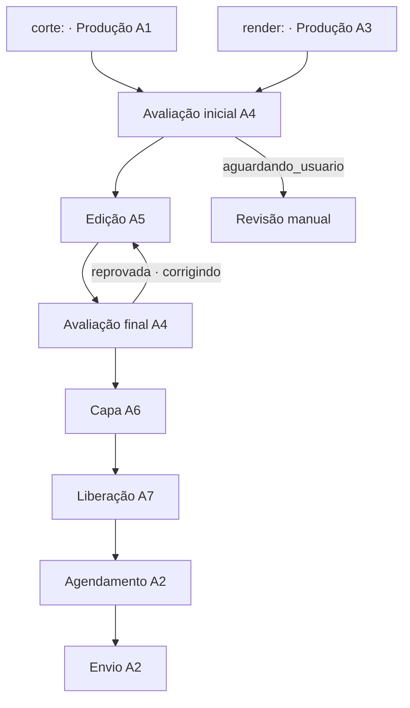
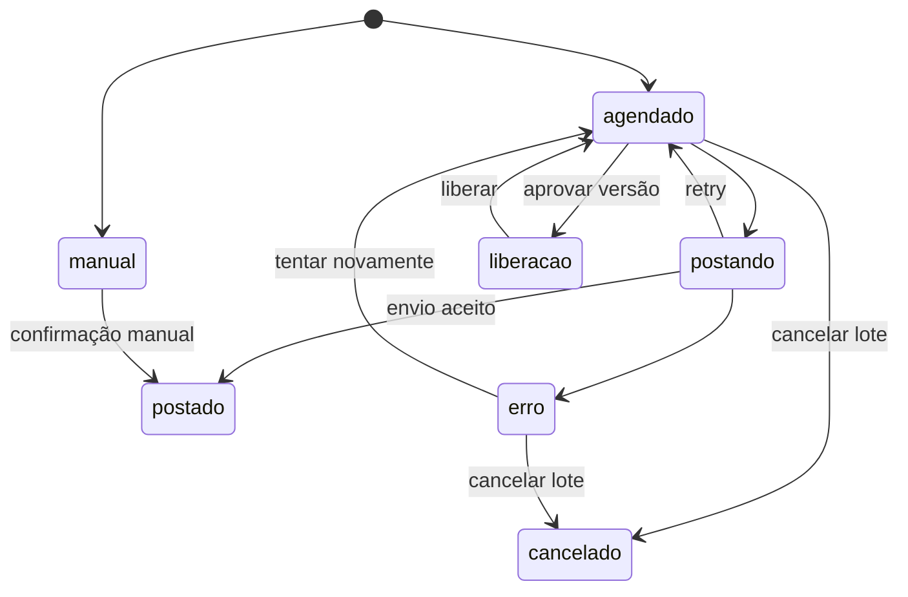

# EstúdioClip 2.0 · Auditoria da Fase 0

**Estado: PARCIAL · Fase 1 bloqueada.** Auditoria de 24/11/2026. A execução local usou a `main` em `b948059ad7c88a13bd7750623298f087fed75a2d` numa branch isolada. A branch padrão do repositório, `claude/project-thread-f8ttca` em `abb36a6cf0f61db0a437a64f23ab70360721bc93`, divergia em 54 arquivos e não incluía o conjunto mais recente de alterações de publicação. A `main` é a origem do workflow do Pages e contém o PR de TikTok assistido. O site público respondeu HTTP 200 e a [execução de referência do Pages](https://github.com/raniere3000-tech/ia/actions/runs/45386616096) terminou com sucesso para esse SHA. A versão do servidor do usuário, a correspondência entre o código local e o aparelho, as contas e os dados reais seguem não verificados.

A auditoria tomou como referência os 11 documentos do pacote, incluindo checklist e instruções de execução. O arquivo `config/estudioclip-2.0-flags.json` declara as cinco flags em `false`. É um inventário inicial sem consumidores no aplicativo. A proposta de PR contém somente documentação e essa configuração inativa, sem migração ou alteração de código em execução. Reverter o commit da auditoria remove os dois arquivos.

## Sequência de tarefas

| Ordem | Tarefa | Evidência mínima antes de avançar | Estado |
|---|---|---|---|
| 0.1 | Descompactar, conferir as instruções e identificar a base | Pacote lido, branch e SHA registradas | Concluída |
| 0.2 | Mapear código, dados, telas, rotas e estados | Inventário, fluxo atual e riscos | Concluída |
| 0.3 | Rodar baseline isolada | Testes Python, frontend, build e navegação | Resultados abaixo |
| 0.4 | Ensaiar backup e restauração com dados de teste | Integridade SQLite, mídia e inventário de exclusões | Concluída em ambiente local |
| 0.5 | Conferir ambiente efetivo, backup integral e projetos legados | Versão e caminhos do aparelho, restauração fora da origem, hashes e abertura dos projetos | Bloqueada pelo acesso ao servidor e seus dados |
| 1 | Confiabilidade e estados | Heartbeat A1, mesma fonte no retry, cancelamento, reaprovação por versão, restart e idempotência | Aguarda Fase 0 |
| 2 | Vertentes CUTS e AI_ORIGINAL e edição real | Um vídeo de cada vertente e exportação manual legada, efeitos verificados em arquivo | Aguarda Fase 1 |
| 3 | Publicação multirrede | Estado e retry independentes, TikTok assistido, lote, OAuth e revalidação da versão | Aguarda Fase 2 |
| 4 | Inteligência e DNA do canal | Proveniência das métricas e versões de DNA, rollback e rotas legadas | Aguarda Fase 3 |
| 5 | Aprendizado supervisionado | Feedback persistente por canal/vertente, teste, decisão e reversão | Aguarda Fase 4 |
| 6 | Piloto e implantação gradual | Homologação, backup recuperável, rollback e aprovação explícita | Aguarda Fase 5 |

Cada fase tem branch e PR próprios. O relatório da fase registra testes, riscos residuais e rollback. A aprovação de implantação é específica para a fase.

## Inventário do código atual

Rotas de servidor são relativas à origem configurada no app. A coluna “Funciona” descreve apenas evidência local e o ambiente de produção segue não verificado, exceto a resposta HTTP pública do Pages.

| Capacidade | Código | Endpoint | Tela | Teste | Existe | Funciona | Problema | Risco | Ação |
|---|---|---|---|---|---|---|---|---|---|
| Navegação legada | `App.tsx`, `navigation/rotas.ts` | — | Cinco áreas e aliases `#manual`, `#agendar`, `#coordenador`, entre outros | `rotas.test.ts`, `e2e-areas.cjs` | Sim | Testes unitários de rotas | Abertura com dados reais pendente | Quebra de atalhos | Manter aliases e extras nas fases seguintes |
| Radar, fonte por link e cortes A1 | `agente.py`, `servidor.py`, `segmentos.py`, `fila.py`, `lib/radar.ts` | `/agente`, `/agente/cortes/manual`, `/agente/cortes/{id}/video` | Radar, Cortes e Agente 1 | `teste_busca_canais.py`, `teste_link_original.py`, `teste_esteira_corte_salvo.py` | Sim | Casos controlados conforme suite | Fonte sem legenda, retry e atividade real precisam de ensaio completo | Troca de fonte ou trabalho invisível | Preservar origem e testar com arquivo e sem legendas |
| Live | `live.py`, `rotas_esteira.py`, `lib/live.ts` | `/api/v1/live`, `/api/v1/live/comecar`, `/api/v1/live/{id}/parar` | Live | `teste_live.py` | Sim | Casos controlados conforme suite | Captura externa por verificar | Sessão interrompida e mídia parcial | Ensaio com live autorizada e parada |
| Projetos, manual, templates, vozes e galeria | `projetos.py`, `exportacao.py`, `visual_presets.py`, `criativo.py`, `lib/store.ts`, `lib/editor.ts` | `/api/v1/projetos`, `/api/v1/projetos/{id}/exportar`, `/api/v1/criativo/assets`, `/estilos-visuais` | Montagem manual, Projetos, Templates, Vozes, Galeria | `teste_exportacao.py`, `teste_estilos_editar.py`, `teste_criativo.py` | Sim | Projeto de teste recuperado no SQLite | Projetos antigos reais e exportação no aparelho pendentes | Perda de referência a ativos e incompatibilidade | Abrir projeto antigo com mídia e exportar cópia em homologação |
| Produção original, séries e lote A3 | `produtor.py`, `series.py`, `storyboard.py`, `linhas_conteudo.py` | `/api/v1/agente3/projetos`, `/api/v1/series`, `/api/v1/projetos/{id}/produzir` | Estúdio IA, Séries e Produção em lote | `teste_agente3.py`, `teste_serie_completa.py`, `teste_aceite_linha6.py` | Sim | Casos controlados conforme suite | Geração externa e consistência em projeto real pendentes | Divergência de personagens ou etapa sem artefato | Testar fluxo autorizado em ambiente de homologação |
| Diretor A4, Editor A5 e reaprovação | `diretor.py`, `diretor_qualidade.py`, `editor_ia.py`, `renderizador.py`, `pipeline.py`, `aprovacoes.py` | `/api/v1/pipeline/jobs`, `/api/v1/projetos/{id}/revisao`, `/api/v1/projetos/{id}/aprovar` | Aprovações, Projetos e Esteira | `teste_diretor.py`, `teste_pipeline_5_agentes.py`, `teste_versao_refeita.py`, `teste_exportacao.py` | Sim | Ensaios da suite conforme resultado | Compatibilidade de versão e render em Termux pendentes | Aprovação reaproveitada ou MP4 incompleto | Comparar hashes, notas e mídia real antes/depois |
| Capas A6 | `thumbnails.py`, `api_v1.py` | `/api/v1/thumbnails/jobs`, `/api/v1/thumbnails/jobs/{id}/variantes` | Capas e galeria | `teste_thumbnails.py`, `teste_gancho_capa.py` | Sim | Ensaios da suite conforme resultado | Refazer e rejeitar com troca de versão real por verificar | Capa da versão anterior ou frase incompleta | Verificar seleção, vínculo, rejeição e refação |
| Coordenador A7, esteira e fila | `coordenador.py`, `esteira.py`, `fila.py`, `orquestrador.py`, `decisoes.py`, `painel.py` | `/api/v1/coordenador`, `/api/v1/esteira/execucoes`, `/api/v1/fila` | Agentes, Coordenador, Execuções, Início | `teste_coordenador.py`, `teste_esteira_7.py`, `teste_cancelamento.py`, `teste_decisoes.py` | Sim | Casos controlados conforme suite | A1 real e cancelamento em todas as etapas ainda precisam de ensaio | Tarefa parada aparenta rodar ou perde decisão | Provar heartbeat e cancelamento persistente em cada etapa |
| Agendamento e status por rede A2 | `postagem.py`, `agenda_postagem.py`, `publicacao_lotes.py`, `lib/filtrosPosts.ts` | `/posts`, `/posts/lotes`, `/api/v1/agent2/schedules` | Publicações e Programação diária | `teste_agenda_agente2.py`, `teste_redes_independentes.py`, `teste_publicacao_lotes.py`, `filtrosPosts.test.ts` | Sim | Filtro validado em teste; servidor conforme suite | APIs e contas reais pendentes | Republicação de rede já concluída | Preservar independência e validar reconciliação após restart |
| TikTok assistido | `tiktok_assistido.py`, `postagem.py`, `TikTokInfo.tsx` | `/posts/{id}/tiktok` e ações correlatas | Posts e contas | `teste_tiktok_assistido.py` | Sim | Mapeamento em testes locais conforme suite | Fluxo global também usa `redes.tiktok.status`; confirmar que rascunho não libera publicação indevidamente | Falso publicado ou metadados perdidos | Testar histórico e confirmação real sem duplicar envio |
| OAuth, integrações e cofre | `postagem.py`, `cofre.py`, `integracoes.py`, `lib/cofre.ts` | `/contas`, `/contas/{provedor}/login`, `/api/v1/integracoes/capacidades` | Posts, Ajustes e contas | `teste_redes_independentes.py` e simuladores relevantes | Sim | Escopos reais não verificados | Há fluxo de cofre com dados desbloqueados em `sessionStorage`; auditar quais chaves seguem por integração e cliente | Credencial expirada ou armazenamento no cliente | Conferir permissões no aparelho e no provedor sem extrair valores |
| Inteligência viral, memória e skills | `aprendizado.py`, `inteligencia_viral.py`, `coordenador.py`, `skills/` | `/agente/aprendizado`, `/api/v1/viral/*`, `/api/v1/coordenador/aprendizado/sugestoes` | Resultados, Memória e aprendizado, Skills | `teste_aprendizado.py`, `teste_skills_agentes.py` | Parcial | Importação e snapshots conforme suite | Central analítica v2 e DNA por canal não verificados; registro da skill não prova efeito | Inferência indevida e métricas incompatíveis | Reutilizar os módulos e rastrear origem das métricas |
| Backup e restauração | `banco.py`, `backups.py`, `projetos.py` | `/api/v1/backups`, `/api/v1/backups/{nome}/testar` | Ajustes | Ensaio isolado abaixo | Sim | SQLite, JSON e PNG registrados recuperados | Corte legado fora de `assets`/`renders` excluído mesmo com todas as categorias | Backup com resultado positivo mas mídia incompleta | Inventariar conteúdo real e validar cópia integral fora da origem |

## Estados observados na base

O sistema usa origem `corte:` ou `render:` na esteira, com A1 e A3 respectivamente. A política em execução e exceções de projetos legados dependem da configuração real. A criação da trilha registra um produtor para cada origem e compartilha as etapas posteriores. Estados de job são gravados separadamente em `jobs` e incluem `na_fila`, `rodando`, `aguardando_aprovacao`, `concluido`, `falhou` e `cancelado`, com campos de pausa, cancelamento, lease e heartbeat. O resumo da esteira mapeia estados locais para `em_andamento`, `aguardando_voce`, `bloqueado`, `corrigindo`, `cancelado`, `descartado` ou `publicado`.



Cada etapa após produção começa em `aguardando_dependencia`, passa a `pendente` após conclusão ou `pulada_justificada` da etapa anterior, e pode ficar em fila, em execução, aguardando usuário/recurso ou falhar. A mesma trilha registra histórico e recibos. Conferir a validade dos recibos e da versão antes de liberar.



`posts.json` guarda um mapa de estados por rede. Pausa de lote e data de retry são campos adicionais. Para TikTok, `tiktok_assistido.estado` deriva `pendente_envio`, `agendado`, `enviado_tiktok`, `aguardando_publicacao_manual`, `aguardando_confirmacao`, `publicado`, `falha` ou `cancelado`. Um envio sem link remoto válido pode exigir confirmação independente do estado interno `postado`.

## Persistência e restauração

- Servidor HTTP Python e FFmpeg. O código auditado declara servidor 2.0.0 e API v1. Por padrão `DADOS=~/.estudioclip` e `BANCO_ARQ=$DADOS/database/studio.sqlite`. O banco local chegou a `PRAGMA user_version=13`. `DADOS`, `BANCO_ARQ`, `PASTA_BACKUP` e o destino do backup de mídias podem divergir em execução.
- SQLite guarda projetos, revisões, ativos, renders, aprovações, fila, esteira, agendas, capas e eventos. JSON em `DADOS` complementa o banco com posts, contas e estado dos agentes. Mídias também vivem em `DADOS/videos`, `projects`, `thumbnails` e `rig2d`. O cofre usa uma chave mestra separada, que deve seguir o procedimento próprio do servidor.
- Ensaio local com projeto manual sintético, PNG registrado e corte MP4 legado gerados com FFmpeg. `backups.fazer` e `backups.testar_restauracao` validaram a integridade do banco restaurado, a revisão do projeto, a referência ao PNG e o `posts.json`. `backups.fazer_midias` e `backups.testar_midias` restauraram o PNG em área de teste e verificaram seu SHA-256. Os cinco tipos de mídia foram selecionados. O MP4 fora de `assets`/`renders`, citado no post, ficou ausente do manifesto mesmo quando o teste retornou sucesso.
- O backup do banco usa cópia consistente SQLite, mas os JSONs e as mídias constituem capturas separadas. Ainda falta demonstrar uma restauração coerente de todas as referências reais. Para liberar, obter cópia segura do banco, JSONs, diretórios de mídia e caminhos externos referenciados, testar em ambiente isolado com os envios desabilitados e confirmar que os projetos legados abrem com seus arquivos. Manter chave mestra sob custódia separada, sem registrar valores em GitHub ou nos logs.

## Execução local

Ambiente Linux, Python 3.12.14, Node v24.22.3, npm 11.19.1 e FFmpeg 7.1.5. O workflow de Pages usa Node 22. Servidor, contas e bibliotecas de mídia do Android/Termux estão fora do ambiente de teste.

- Frontend em `frontend/`: `npm ci --no-audit --no-fund`, `npm test` (16/16), `npm run build` (PASS). O build já emite avisos de tamanho de bundle, import estático/dinâmico e comentários de dependência. O artefato rastreado `frontend/tsconfig.tsbuildinfo` foi restaurado após o ensaio.
- Backend em `servidor/`: executar os arquivos `testes/teste_*.py` individualmente. Vários são scripts de asserções e usam stubs. Um processo novo por arquivo mantém os módulos e variáveis de cada fixture isolados. O inventário abaixo registra o status por arquivo. Cobertura percentual não foi medida.
- Navegação no navegador com a fixture do repositório: iniciar `python frontend/testes/e2e-servidor.py` na raiz, rodar Vite Preview na porta 4173 e executar `frontend/testes/e2e-areas.cjs` com Playwright a partir de uma pasta temporária. O servidor de teste usa dados sintéticos e porta 8799.

Para repetir um teste Python isolado em Linux:

```bash
cd servidor
baseline_dir="$(mktemp -d)"
mkdir -p "$baseline_dir/tmp" "$baseline_dir/home"
env HOME="$baseline_dir/home" DADOS="$baseline_dir/data" TMPDIR="$baseline_dir/tmp" PYTHONPATH="$PWD" \
  PYTHONDONTWRITEBYTECODE=1 PYTHONUNBUFFERED=1 timeout 150s python testes/teste_esteira_7.py
```

<details>
<summary>Reproduzir a lacuna de mídia com dados sintéticos</summary>

A partir de `servidor/`, com FFmpeg disponível:

```bash
PYTHONDONTWRITEBYTECODE=1 python - <<'PYTHON'
import hashlib
import json
import os
import sqlite3
import subprocess
import tempfile
from pathlib import Path

with tempfile.TemporaryDirectory() as work:
    root = Path(work)
    os.environ.update(DADOS=str(root / 'origem'), PASTA_BACKUP=str(root / 'backup'))
    import backups, banco, postagem, projetos

    banco.migrar()
    project = projetos.criar({'titulo': 'Baseline', 'tipo': 'manual', 'dados': {'baseline': True}})
    image = projetos.pasta(project['id']) / 'baseline.png'
    cut = postagem.VIDEOS / 'corte-legado.mp4'
    source = ['ffmpeg', '-v', 'error', '-f', 'lavfi', '-i', 'testsrc=size=64x64:rate=10']
    subprocess.run([*source, '-frames:v', '1', str(image)], check=True)
    subprocess.run([*source, '-t', '1', '-pix_fmt', 'yuv420p', str(cut)], check=True)
    projetos.registrar_asset(image, image.name, 'image/png', project['id'], origem='site')
    posts = [{'id': 'fixture', 'video': cut.name, 'redes': {'youtube': {'status': 'postado'}}}]
    postagem.salvar_posts(posts)
    backups.salvar_config_midias({'ligado': True, 'categorias': list(backups.CATEGORIAS)})
    db_backup = backups.fazer('baseline fixture')
    media_backup = backups.fazer_midias('baseline fixture')

    db_result = backups.testar_restauracao(db_backup['arquivo'])
    media_result = backups.testar_midias(media_backup['manifesto'])
    restore = Path(db_result['pasta'])
    assert db_result['ok'] and db_result['projetos'] == 1
    assert media_result['ok'] and media_result['conferidos'] == 1
    assert json.loads((restore / 'posts.json').read_text()) == posts
    with sqlite3.connect(restore / 'studio.sqlite') as restored:
        assert restored.execute('PRAGMA integrity_check').fetchone()[0] == 'ok'
    manifest = Path(media_backup['destino']) / media_backup['manifesto']
    hashes = {item['sha256'] for item in json.loads(manifest.read_text())['itens']}
    assert hashlib.sha256(image.read_bytes()).hexdigest() in hashes
    assert hashlib.sha256(cut.read_bytes()).hexdigest() not in hashes
    print('Backup recuperável para o que cadastrou, com corte legado ausente.')
PYTHON
```

</details>

### Resultados da execução

**Backend (51 scripts): 40 PASS, 9 FAIL, 1 TIMEOUT e 1 manual.** A primeira rodada foi realizada no código-base limpo. Foi necessário repetir os três scripts de skills com `PYTHONPATH=.` e o teste de trecho com `yt-dlp 2026.11.23` instalado em diretório separado. Nesses quatro casos a tabela usa a segunda tentativa.

| Script | Resultado |
|---|---|
| `teste_3d.py` | PASS |
| `teste_aceite_linha6.py` | PASS |
| `teste_agenda_agente2.py` | PASS |
| `teste_agente3.py` | TIMEOUT |
| `teste_alertas.py` | PASS |
| `teste_aprendizado.py` | PASS |
| `teste_busca_canais.py` | PASS |
| `teste_cancelamento.py` | PASS |
| `teste_central_automacao.py` | FAIL |
| `teste_comandos.py` | FAIL |
| `teste_comparacao.py` | PASS |
| `teste_coordenador.py` | FAIL |
| `teste_criativo.py` | PASS |
| `teste_custo_corte.py` | PASS |
| `teste_decisoes.py` | PASS |
| `teste_descricao.py` | FAIL |
| `teste_diretor.py` | PASS |
| `teste_email.py` | MANUAL |
| `teste_esteira_7.py` | PASS |
| `teste_esteira_corte_salvo.py` | PASS |
| `teste_estilos_agente1.py` | PASS |
| `teste_estilos_editar.py` | PASS |
| `teste_estilos_visuais.py` | FAIL |
| `teste_exportacao.py` | FAIL |
| `teste_ffmpeg_tempo.py` | PASS |
| `teste_gameplay.py` | PASS |
| `teste_gancho_capa.py` | PASS |
| `teste_kwai_diario.py` | PASS |
| `teste_liberacao.py` | FAIL |
| `teste_liberar_corte.py` | PASS |
| `teste_link_original.py` | PASS |
| `teste_live.py` | PASS |
| `teste_motor.py` | PASS |
| `teste_pacote.py` | PASS |
| `teste_painel.py` | PASS |
| `teste_perfis.py` | PASS |
| `teste_pipeline_5_agentes.py` | PASS |
| `teste_publicacao_lotes.py` | PASS |
| `teste_redes_independentes.py` | PASS |
| `teste_reposicao.py` | FAIL |
| `teste_serie_completa.py` | PASS |
| `teste_site_lote1.py` | PASS |
| `teste_skills.py` | PASS |
| `teste_skills_agentes.py` | FAIL |
| `teste_skills_novas.py` | PASS |
| `teste_temas.py` | PASS |
| `teste_thumbnails.py` | PASS |
| `teste_tiktok_assistido.py` | PASS |
| `teste_trecho_link.py` | PASS |
| `teste_versao_refeita.py` | PASS |
| `teste_whatsapp.py` | PASS |

Falhas existentes na revisão de referência, com origem a confirmar:

- `central_automacao`, `comandos`, `coordenador`, `descricao` e `liberacao`: fixtures de aprovação ou publicação não chegaram ao estado esperado. Em vários casos o servidor exigiu parecer favorável do Diretor para a versão. O Coordenador também não atualizou o hash de capa esperado pelo teste.
- `exportacao`: o render de duas fixtures gerou partes mais curtas que a duração esperada (2,00 s em vez de 2,40 s e 1,20 s em vez de 1,60 s). Asserções de localização da falha e diagnóstico também falharam.
- `estilos_visuais`: `industrial_impacto` e `retro_vhs` ainda alteraram a imagem com intensidade zero no ambiente local.
- `reposicao`: divergência nas expectativas de quando fazer um pedido ao Coordenador e quando suprimi-lo.
- `skills_agentes`: a fixture passada à conferência A2 não contém `redes`; a execução chega a `KeyError: redes`.
- `agente3`: a fixture fica bloqueada no passo de produção após a fila registrar o limite de orçamento de R$ 2,00. A primeira rodada foi interrompida ao atingir 150 s.
- `email`: script interativo. A tentativa sem entrada terminou em EOF. Envio e recebimento reais não verificados.

Entre os resultados positivos, a esteira de sete agentes teve 70 verificações, o pipeline de cinco agentes 51, a agenda do A2 45, o TikTok assistido 36 e os lotes 12. São resultados locais com dados de teste.

**Navegador: 93 PASS e 2 FAIL.** Playwright com Chromium headless 153 executou as cinco larguras (360, 390, 768, 1024 e 1440 px), verificou 21 hashes antigos, os sete agentes, a permanência da montagem manual em navegação e o vínculo com o servidor local de teste. As duas divergências anteriores às mudanças foram o texto no indicador de aprovações e a expectativa de nove itens no submenu de Agentes. A fixture anuncia esteira desligada, mas não fixa `ESTEIRA_COMPLETA=0`, e o registro atual declara dez entradas de menu nessa área. A primeira tentativa não pôde iniciar o wrapper Chromium do ambiente. A execução completa usou um binário instalado fora do repositório.

## Aceite pendente

1. Identificar a revisão e o ambiente efetivos do servidor, suas opções de inicialização, SQLite, volumes de mídia, versões de ferramentas e status de permissões por rede. Registrar apenas dados de diagnóstico sem credenciais.
2. Fazer uma cópia integral e consistente dos dados reais e verificar restauração fora da origem. Conferir explicitamente cortes legados, renders, capas e todos os arquivos referenciados por projetos e posts, inclusive caminhos externos. A restauração de teste deve estar isolada das contas e rotinas de produção.
3. Abrir amostras antigas em homologação, conferir suas mídias e confirmar os fluxos críticos em Android/Termux, se for o ambiente em uso. Verificar autenticidade e escopos das conexões pelas telas dos provedores e pela configuração local.
4. Investigar as falhas de baseline ou registrar disposição explícita para cada uma antes de medir regressões novas. Revisão do diff e rollback do primeiro trabalho funcional ficam na Fase 1, após a aprovação do aceite da Fase 0.
