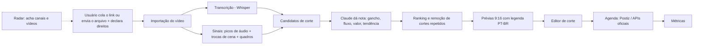

# Estúdio de Cortes — estrutura de construção

Versão 8 unificada (V7 + catálogo V6) · 10/11/2026 · Projeto: Radar multitemático e estúdio de cortes

> **Como usar este arquivo:** as seções 1 a 11 explicam o que construir. As seções 12 e 13 trazem toda a configuração e a ordem dos pedidos para construir com o Claude Code. Salve este arquivo como `docs/estrutura.md` dentro do repositório, para o Claude Code poder lê-lo.

Uma plataforma multitemática de descoberta de canais e edição de vídeos, inspirada em recursos documentados do ViceScale e do OpusClip. O usuário acha canais no Radar, cola o link de um vídeo (ou envia o arquivo), e o sistema mostra vários cortes prontos, com nota de viralidade, legenda em português e template. Depois agenda as postagens pelas APIs oficiais. Tudo com ferramentas abertas do GitHub, rodando no seu computador e em planos gratuitos.

**O que muda da versão 1:** o Radar não exige mais autorização para mostrar canais. O pedido de autorização vira recurso opcional. O editor trabalha com o vídeo que o usuário traz, um de cada vez, e o usuário declara ter direito sobre ele. Não há download em massa de perfis nem repostagem automática de terceiros.

---

## 1. Abas do sistema

| Aba | Inspiração | O que faz |
| --- | --- | --- |
| Radar | ViceScale (busca de perfis) | Acha canais e vídeos em alta por nicho; pedido de autorização opcional |
| **Cortes por Link** | OpusClip (dashboard) | Cola um link ou envia um arquivo e recebe vários cortes com nota de 0 a 99 |
| Editor de corte | OpusClip (editor) | Ajusta início e fim, legenda, layout, título |
| Templates | ViceScale (Templates) | Logo, cores, crédito, capa, abertura e fechamento |
| Agenda | ViceScale e OpusClip (agendador) | Posta pelas APIs oficiais, no ritmo escolhido |
| Métricas | — | Visualizações, cliques de afiliado, vendas |

---

## 2. Arquitetura



**Onde cada parte roda (custo zero):**

| Parte | Onde roda | Por quê |
| --- | --- | --- |
| Painel (site) | Lovable ou Vercel, plano grátis | Interface |
| Banco de dados | Supabase, plano grátis | Trabalhos, cortes, posts, métricas |
| Processamento de vídeo | **Seu computador** (worker local) | Cortar, transcrever e legendar pesa; no PC é grátis |
| Vídeos | Seu computador ou Google Drive | O plano grátis do Supabase tem pouco espaço |
| Postagem | Postiz auto-hospedado (Docker) | Já integra TikTok, Instagram e YouTube |
| Inteligência | Claude | Notas, títulos, tradução; único custo variável |

---

## 3. Aba Cortes por Link (como o OpusClip)

### 3.1 Como o OpusClip faz

- **Entrada:** link (YouTube, Vimeo, Zoom, MP4 público) ou arquivo enviado. Cobra 1 crédito por minuto de vídeo, até 10 horas por arquivo.
- **Dois modelos de corte:**
  - **ClipBasic:** trabalha só com a transcrição. Bom para vídeos falados.
  - **ClipAnything:** "analisa cada quadro por sinais visuais, de áudio e de sentimento", identificando objetos, cenas, ações, sons, emoções e texto, e dá a cada cena uma nota de potencial viral. Pode não achar nada em vídeos sem áudio ou com pouca ação.
- **Prompt em linguagem natural:** o usuário descreve o que quer ("ache onde ele fala de preço") e pode refazer o pedido na tela de resultados sem reimportar.
- **Trecho a processar:** escolher só uma parte do vídeo, para gastar menos.
- **Nota de viralidade de 0 a 99**, feita de quatro avaliações: **gancho, fluxo, valor e tendência**. Os cortes aparecem do maior para o menor. Testes independentes mostram que a nota nem sempre acerta quais cortes vão bem, então ela serve como lista de prioridade, não como previsão.
- **Reframe:** acompanha os objetos e ações e reenquadra em 9:16, 1:1 ou 16:9.
- **Editor:** corrigir palavras da legenda, apagar trechos, mover a legenda, trocar fonte, cor e contorno, puxar outro trecho do vídeo.
- **Saída:** exportar ou agendar para YouTube, Instagram, TikTok e outras redes.
- **Tempo:** o ClipAnything leva de 20 a 40 minutos por vídeo.

### 3.2 Como vamos replicar: o motor de cortes

1. **Importar.** Link (yt-dlp) ou arquivo enviado. Antes de processar, o usuário marca: "Declaro que tenho direito de usar e publicar este vídeo". Um link por vez, sempre iniciado pelo usuário.
2. **Transcrever.** faster-whisper ou WhisperX, com o tempo de cada palavra.
3. **Medir sinais** (o equivalente ao ClipAnything):
   - picos de volume e de energia do áudio (tiros, explosões, gritos, risadas);
   - trocas de cena (PySceneDetect);
   - opcional, modo "Gameplay/ação": 1 quadro a cada 2 segundos enviado ao Claude com visão, que descreve o que acontece (perseguição, batida, morte, fuga, pouso). Dá mais qualidade em gameplay sem fala, mas custa mais.
4. **Montar candidatos.** Janelas com a duração escolhida, começando e terminando em fim de frase ou troca de cena, centradas nos picos.
5. **Dar nota com o Claude.** Para cada candidato, notas de 0 a 99 em gancho, fluxo, valor e tendência, mais o título e o motivo; a interface mostra também a equivalência de 0 a 10. Nota final = média ponderada (gancho pesa mais).
6. **Ordenar, filtrar e limpar.** Remover cortes que se sobrepõem mais de 50%, ordenar por nota e gerar prévias dos candidatos com nota visível superior a 3/10; permitir quantidade configurável (padrão até 15) e nunca inventar cortes suficientes para preencher o limite.
7. **Gerar prévias.** FFmpeg corta, reenquadra para 9:16 e aplica legenda em português e o template.
8. **Refazer com prompt.** Na tela de resultados, um novo prompt reaproveita a transcrição e os sinais já calculados, sem reimportar.

**Critérios de nota:**

| Critério | Peso | O que avalia |
| --- | --- | --- |
| Gancho | 35% | Os 3 primeiros segundos prendem? Começa na ação, sem enrolação? |
| Fluxo | 25% | O corte tem começo, meio e fim? Não corta no meio de uma frase ou jogada? |
| Valor | 25% | Diverte, surpreende ou ensina algo (jogada épica, bug, falha engraçada, dica)? |
| Tendência | 15% | Tem a ver com o que está em alta (GTA 6, atualização, missão nova, meme)? |

**Modelo de pedido ao Claude:**

```
Você avalia trechos de vídeos de qualquer nicho para virar cortes curtos (TikTok, Reels, Shorts). Adapte gancho, fluxo, valor e tendência ao tema e ao contexto do vídeo; gameplay de GTA é apenas um exemplo.
Para cada candidato abaixo você recebe: início, fim, transcrição, picos de áudio, trocas de cena e descrição dos quadros.
{prompt_do_usuario, se houver}
Dê notas de 0 a 99 para gancho, fluxo, valor e tendência, um título em português de até 60 caracteres e o motivo em 1 frase.
Sugira ajustes de início/fim de até 3 segundos se melhorarem o gancho.
Responda só com um array JSON:
[{"id": "...", "gancho": 0, "fluxo": 0, "valor": 0, "tendencia": 0, "titulo": "...", "motivo": "...", "inicio": 0.0, "fim": 0.0}]
```

### 3.3 Telas da aba

**Tela 1 — Novo trabalho**

| Campo | Opções | Padrão |
| --- | --- | --- |
| Link ou arquivo | Colar link ou arrastar arquivo | — |
| Declaração de direitos | Caixa obrigatória | Desmarcada |
| Modelo | Falas (só transcrição) · Gameplay/ação (transcrição + áudio + quadros) | Gameplay/ação |
| Duração dos cortes | até 30 s · 30–60 s · 61–90 s · 90–180 s | 61–90 s |
| Trecho a processar | Início e fim no vídeo | Vídeo inteiro |
| Prompt (opcional) | Texto livre, ex.: "perseguições policiais" | Vazio |
| Idioma da legenda | Português · Original · Sem legenda | Português |
| Estilo da legenda | Palavra destacada · Karaokê · Simples | Palavra destacada |
| Formato | 9:16 · 1:1 · 16:9 | 9:16 |
| Layout | Tela cheia · Fundo desfocado · Facecam em cima | Fundo desfocado |
| Template | Templates salvos | Template do canal |

Botão: **Gerar cortes**.

**Tela 2 — Processando**

Barra de progresso por etapa: Importando → Transcrevendo → Analisando áudio e cenas → Avaliando trechos → Gerando prévias. Aviso no celular quando terminar.

**Tela 3 — Resultados** (grade de cartões, do maior para o menor)

Cada cartão mostra:
- prévia em 9:16 que toca ao passar o dedo ou o mouse;
- nota final grande e as 4 notas menores (gancho, fluxo, valor, tendência);
- título sugerido (editável) e o motivo;
- tempo no vídeo original (ex.: 12:04–13:21) e duração;
- botões: **Editar**, **Baixar**, **Agendar**, **Descartar**.

No topo: filtro por nota mínima, ordenação, e o campo **"Refazer com outro prompt"**.

**Tela 4 — Editor de corte**
- linha do tempo simples com alças de início e fim;
- transcrição clicável: apagar palavras apaga o trecho do vídeo;
- legenda: corrigir texto, posição, fonte, cor, contorno;
- trocar layout e template;
- 3 opções de título geradas pelo Claude;
- **Salvar** gera o arquivo final.

### 3.4 Ferramentas da aba

| Ferramenta | Link | Uso |
| --- | --- | --- |
| yt-dlp | https://github.com/yt-dlp/yt-dlp | Importar pelo link. Os termos do YouTube restringem downloads; o arquivo enviado é o caminho mais seguro |
| faster-whisper | https://github.com/SYSTRAN/faster-whisper | Transcrição na CPU |
| WhisperX | https://github.com/m-bain/whisperX | Tempo palavra por palavra |
| PySceneDetect | https://github.com/Breakthrough/PySceneDetect | Trocas de cena |
| Clip-Finder | https://github.com/fuzakeru757/Clip-Finder | Picos de áudio em gameplay |
| Auto-clipper | https://github.com/bendawg2010/Auto-clipper | Destaques de gameplay por detecção de objetos |
| AI-Youtube-Shorts-Generator | https://github.com/Anil-matcha/AI-Youtube-Shorts-Generator | Base do motor: transcrição + IA + recorte 9:16 |
| ClippedAI | https://github.com/Shaarav4795/ClippedAI | Alternativa aberta ao OpusClip, para comparar |
| VideoHighlighter | https://github.com/thewbuk/VideoHighlighter | Análise visual local, alternativa offline ao modo de quadros |
| FFmpeg | https://ffmpeg.org | Corte, 9:16, fundo desfocado, logo |
| whisper-word-captions | https://github.com/philippprimisser-max/whisper-word-captions | Legenda com palavra destacada |
| ai-video-captions | https://github.com/nicolaigaina/ai-video-captions | Estilos de legenda animada |

### 3.5 Rotas da API do painel

| Rota | O que faz |
| --- | --- |
| `POST /trabalhos` | Cria um trabalho com link ou arquivo e as opções da Tela 1 |
| `GET /trabalhos/:id` | Status e progresso por etapa |
| `GET /trabalhos/:id/cortes` | Lista de cortes com notas |
| `POST /trabalhos/:id/refazer` | Novo prompt, reaproveitando transcrição e sinais |
| `PATCH /cortes/:id` | Salva ajustes do editor |
| `POST /cortes/:id/render` | Gera o arquivo final |
| `POST /cortes/:id/agendar` | Manda para a agenda |

---

## 4. Radar de Canais (detalhes e padrões completos na seção 15)

| Ferramenta | Link | Uso |
| --- | --- | --- |
| YouTube Data API v3 | https://developers.google.com/youtube/v3 | Buscar canais por nicho e os vídeos mais vistos. Cota grátis de 10.000 unidades por dia |
| Radar de Canais (já publicado) | — | Lista de canais, status e mensagem de pedido de autorização (opcional) |
| Apify (conector ligado) | https://apify.com/store | Dados públicos de perfis do TikTok e Instagram |

Cada vídeo em alta no Radar ganha o botão **"Abrir em Cortes por Link"**, que preenche o link na Tela 1. O usuário ainda precisa marcar a declaração de direitos.

---

## 5. Templates e Agenda

| Ferramenta | Link | Uso |
| --- | --- | --- |
| Remotion | https://github.com/remotion-dev/remotion | Template em código: abertura, crédito, capa |
| Canva (conector ligado) | — | Desenhar template e capas |
| Postiz | https://github.com/gitroomhq/postiz-app | Agendador aberto com TikTok, Instagram e YouTube |
| Postiz Agent | https://github.com/gitroomhq/postiz-agent | Claude agenda posts no Postiz |
| n8n | https://github.com/n8n-io/n8n | Automação entre worker, banco e Postiz |

**APIs oficiais de postagem:**

| Plataforma | Documentação | Requisitos |
| --- | --- | --- |
| TikTok | https://developers.tiktok.com/doc/content-posting-api-get-started | App aprovado. **Até passar na auditoria, os posts saem como privados.** Pedir cedo. [Regras de compartilhamento](https://developers.tiktok.com/docs/en/content-sharing-guidelines) |
| Instagram | https://developers.facebook.com/docs/instagram-platform/content-publishing | Conta Profissional ligada a um app da Meta |
| YouTube Shorts | https://developers.google.com/youtube/v3/guides/uploading_a_video | Projeto no Google Cloud; cerca de 6 uploads por dia na cota grátis |

---

## 6. Skills e conectores que já temos

| Skill ou conector | Onde ajuda |
| --- | --- |
| Lovable | Construir o painel e o banco |
| Google Drive | Receber arquivos de vídeo |
| Gmail | Pedidos de autorização (opcional) |
| Apify e skills apify | Dados públicos de canais |
| Canva | Template e capas |
| adobe-edit-quick-cut e adobe-resize | Testes rápidos de corte e 9:16 |
| video-making | Abertura e chamadas de afiliado |
| playwright-cli | Testar o painel automaticamente |
| marketing: content-creation | Títulos, descrições, hashtags |
| data: build-dashboard | Painel de métricas |
| skill-creator | Transformar o fluxo numa skill de um comando |
| Repositório oficial de skills | https://github.com/anthropics/skills |
| Lista da comunidade | https://github.com/VoltAgent/awesome-agent-skills |

---

## 7. Estrutura de pastas

```
estudio-de-cortes/
├── painel/                   # site (Lovable / React)
│   └── paginas/              # radar, novo-trabalho, resultados, editor, agenda, metricas
├── worker/                   # roda no seu computador
│   ├── importar.py           # link (yt-dlp) ou arquivo
│   ├── transcrever.py        # faster-whisper / WhisperX
│   ├── sinais.py             # picos de áudio, cenas, quadros
│   ├── candidatos.py         # janelas de corte
│   ├── notas.py              # Claude: gancho, fluxo, valor, tendência
│   ├── ranking.py            # ordenar e remover repetidos
│   ├── render.py             # FFmpeg: 9:16, layout, legenda, template
│   └── fila.py               # lê e atualiza o Supabase
├── postagem/
│   └── docker-compose.yml    # Postiz
├── templates/
├── supabase/schema.sql
├── .env.example              # chaves (nunca no GitHub)
└── README.md
```

---

## 8. Banco de dados

| Tabela | Campos principais |
| --- | --- |
| canais | id, nome, plataforma, link, nicho, status_autorizacao (opcional), observacoes |
| trabalhos | id, origem (link ou arquivo), declaracao_direitos (sim/não + data), modelo, duracao, trecho, prompt, idioma, estilo_legenda, formato, layout, template_id, status, progresso |
| transcricoes | trabalho_id, palavras (texto + tempo) |
| sinais | trabalho_id, picos_audio, cenas, descricoes_quadros |
| cortes | id, trabalho_id, inicio, fim, gancho, fluxo, valor, tendencia, nota_final, titulo, motivo, arquivo_previa, arquivo_final, status |
| posts | id, corte_id, plataforma, agendado_para, link_post, link_afiliado, status |
| metricas | post_id, data, visualizacoes, curtidas, cliques_afiliado, vendas |
| produtos | id, nome, loja, link_afiliado, categoria |
| configuracoes | horarios, limite_diario, pausado |

Regra: um trabalho só começa se `declaracao_direitos = sim`.

---

## 9. Fases de construção

### Fase 1 — Planta
- [ ] Fechar nome, plataformas, lojas de afiliado, horários
- [ ] Pedir acesso de desenvolvedor no TikTok, Meta e Google

### Fase 2 — Estrutura
- [ ] Instalar no computador: Python, FFmpeg, Docker
- [ ] Criar o Supabase com as tabelas
- [ ] Motor de cortes: importar → transcrever → sinais → candidatos → notas → ranking → render
- [ ] Painel no Lovable: Novo trabalho, Processando, Resultados, Editor
- [ ] Ligar o Radar à aba Cortes por Link
- [ ] Subir o Postiz e conectar as contas

### Fase 3 — Testes
- [ ] Rodar 5 vídeos de gameplay e comparar os cortes com os que você escolheria à mão
- [ ] Comparar a nota do sistema com o desempenho real dos 10 primeiros posts
- [ ] Ajustar pesos e o pedido ao Claude

### Fase 4 — Acabamento
- [ ] Worker rodando sozinho com tarefa agendada
- [ ] Alertas no celular quando um trabalho termina ou um post falha
- [ ] Relatório semanal de vendas e alcance

---

## 10. Custos

| Item | Custo |
| --- | --- |
| Ferramentas do GitHub | Grátis |
| Supabase, Vercel ou Lovable | Grátis nos planos iniciais |
| Processamento no seu computador | Grátis (só energia) |
| APIs das plataformas | Grátis |
| Claude: notas e títulos | Baixo; um pedido por trabalho com todos os candidatos |
| Claude: modo de quadros (visão) | O maior custo; usar só em vídeos sem fala ou só no trecho escolhido |
| Apify | Crédito grátis mensal |

---

## 11. Regras do sistema

1. Declaração de direitos obrigatória antes de processar qualquer vídeo.
2. Um vídeo por vez, sempre iniciado pelo usuário; sem download em massa de perfis.
3. Sem repostagem automática de conteúdo de terceiros.
4. Crédito ao canal original quando o vídeo vier de outro criador.
5. #publi em todo post com link de afiliado.
6. Postagem só pelas APIs oficiais.

---

## 12. Configuração para construir com o Claude Code

### 12.1 Decisão de arquitetura para a versão 1

Tudo roda no seu computador, menos o banco:

| Parte | Tecnologia | Onde |
| --- | --- | --- |
| Painel | React + Vite + TypeScript + Tailwind | `localhost:5173` |
| API e worker | Python 3.11 + FastAPI | `localhost:8000` (serve também as prévias de vídeo) |
| Banco | Supabase (Postgres) | Nuvem, plano grátis |
| Vídeos | Pasta `dados/` no computador | Local |
| Agenda | Postiz no Docker | `localhost:5000` |
| IA | API do Claude (`anthropic` em Python) | Nuvem |

Publicar o painel na internet fica para depois dos testes.

### 12.2 Contas necessárias

| Conta | Para quê | Custo |
| --- | --- | --- |
| Claude Pro ou Max | Usar o Claude Code (o plano grátis do Claude não inclui o Claude Code) | Assinatura |
| Console da Anthropic (console.anthropic.com) | Chave de API para o worker dar notas e títulos. **É cobrada à parte da assinatura**, por uso | Por uso |
| GitHub | Guardar o código | Grátis |
| Supabase | Banco de dados | Grátis |
| Google Cloud | YouTube Data API (Radar) e upload de Shorts | Grátis dentro da cota |
| TikTok for Developers e Meta for Developers | Postagem pelas APIs oficiais | Grátis |

### 12.3 Instalar os programas (Windows)

Abra o PowerShell e rode:

```powershell
# Ferramentas de base
winget install Git.Git
winget install GitHub.cli
winget install Python.Python.3.11
winget install OpenJS.NodeJS.LTS
winget install Gyan.FFmpeg
winget install Docker.DockerDesktop

# Claude Code (instalador nativo)
irm https://claude.ai/install.ps1 | iex
```

Feche e abra o PowerShell, depois confira:

```powershell
git --version; gh --version; python --version; node --version; ffmpeg -version; docker --version; claude --version
```

No macOS ou Linux, o Claude Code instala com `curl -fsSL https://claude.ai/install.sh | bash`, e o resto com o gerenciador de pacotes do sistema (Homebrew ou apt).

### 12.4 Criar o repositório

```powershell
mkdir estudio-de-cortes; cd estudio-de-cortes
git init
mkdir docs, painel, worker, worker\testes, postagem, templates, supabase, dados, .claude\skills, .claude\agents
# copie este arquivo para docs\estrutura.md
gh auth login
gh repo create estudio-de-cortes --private --source . --remote origin
claude
```

O primeiro `claude` abre o navegador para você entrar com a sua conta.

### 12.5 `CLAUDE.md` (na raiz do repositório)

O Claude Code lê este arquivo no início de toda sessão.

````markdown
# Estúdio de Cortes

Sistema multitemático para descobrir canais, transformar vídeos longos autorizados em cortes verticais com legendas, notas de viralidade e agendamento. A especificação completa está em `docs/estrutura.md`. Leia a seção relevante antes de construir qualquer módulo.

## Arquitetura
- `painel/`: React + Vite + TypeScript + Tailwind. Interface em português do Brasil.
- `worker/`: Python 3.11 + FastAPI. API em `localhost:8000` e processamento de vídeo.
- `supabase/schema.sql`: fonte da verdade do banco.
- `dados/`: vídeos e arquivos gerados. Nunca vai para o Git.
- `postagem/`: Postiz no Docker.

## Comandos
- Worker: `cd worker; python -m venv .venv; .venv\Scripts\activate; pip install -r requirements.txt`
- Rodar API: `uvicorn api:app --reload --port 8000` (dentro de `worker/`)
- Rodar a fila: `python fila.py` (dentro de `worker/`)
- Testes do worker: `pytest -q` (dentro de `worker/`)
- Painel: `cd painel; npm install; npm run dev`
- Testes do painel: `npm test` (dentro de `painel/`)

## Pipeline do motor de cortes
importar → transcrever → sinais → candidatos → notas → ranking → render. Cada etapa é um arquivo em `worker/`, com uma função principal, entrada e saída em JSON, e teste em `worker/testes/`. Cada etapa grava o progresso na tabela `trabalhos`.

## Regras obrigatórias
- Nenhum trabalho é processado se `declaracao_direitos` for falsa. Validar na API e no banco.
- Importação é um vídeo por vez, iniciada pelo usuário. Não criar download em massa de perfis ou canais.
- Não criar repostagem automática de conteúdo de terceiros.
- Postagem só pelas APIs oficiais (via Postiz).
- Segredos só no `.env`. Nunca escrever chaves no código nem ler o `.env` em voz alta no chat.

## Convenções
- Nomes de tabelas, campos e arquivos em português, sem acento, como em `docs/estrutura.md`.
- Textos da interface em português do Brasil.
- Modelos do Claude: `claude-sonnet-5-5` para notas e títulos; `claude-haiku-4-5-20251001` para tarefas simples.
- Pedidos ao Claude ficam em `worker/prompts/*.txt`, nunca soltos no código.
- Depois de mudar um módulo do worker, rodar `pytest -q` antes de dizer que terminou.
````

### 12.6 `.claude/settings.json` (permissões e ganchos)

```json
{
  "permissions": {
    "allow": [
      "Bash(python:*)",
      "Bash(pip install:*)",
      "Bash(pytest:*)",
      "Bash(ruff:*)",
      "Bash(npm install:*)",
      "Bash(npm run:*)",
      "Bash(npm test:*)",
      "Bash(ffmpeg:*)",
      "Bash(ffprobe:*)",
      "Bash(git status)",
      "Bash(git diff:*)",
      "Bash(git add:*)",
      "Bash(git commit:*)"
    ],
    "deny": [
      "Read(./.env)",
      "Read(./.env.*)",
      "Bash(git push --force:*)"
    ]
  },
  "hooks": {
    "PostToolUse": [
      {
        "matcher": "Edit|Write",
        "hooks": [
          {
            "type": "command",
            "command": "ruff format --quiet worker || true"
          }
        ]
      }
    ]
  }
}
```

O gancho formata o código Python depois de cada edição. A regra `deny` impede o Claude Code de ler o arquivo de chaves.

### 12.7 `.mcp.json` (conectores do projeto)

```json
{
  "mcpServers": {
    "supabase": {
      "type": "http",
      "url": "https://mcp.supabase.com/mcp?project_ref=SEU_PROJECT_REF&features=database,docs"
    },
    "playwright": {
      "type": "stdio",
      "command": "npx",
      "args": ["-y", "@playwright/mcp@latest"]
    }
  }
}
```

- **Supabase:** o Claude Code cria tabelas e consulta o banco. Troque `SEU_PROJECT_REF` pelo código do projeto (aparece na URL do painel do Supabase). Para autenticar, dentro do `claude` rode `/mcp`, escolha `supabase` e `Authenticate`. Depois que o banco estiver pronto, acrescente `&read_only=true` à URL para evitar mudanças acidentais.
- **Playwright:** o Claude Code abre o painel no navegador e testa as telas sozinho.

Confira com `claude mcp list` no terminal.

### 12.8 Skills do projeto

**`.claude/skills/modulo-worker/SKILL.md`**

```markdown
---
name: modulo-worker
description: Cria ou altera uma etapa do motor de cortes em worker/ (importar, transcrever, sinais, candidatos, notas, ranking, render) seguindo o padrão do projeto, com teste.
---

1. Leia a seção 3.2 de docs/estrutura.md e o arquivo da etapa anterior para saber o formato de entrada.
2. A etapa tem uma função principal `executar(trabalho_id: str, entrada: dict) -> dict`, sem efeitos fora de `dados/<trabalho_id>/`.
3. Salve a saída em `dados/<trabalho_id>/<etapa>.json` e atualize `trabalhos.progresso` e `trabalhos.etapa` no Supabase.
4. Erros: grave `trabalhos.status = 'erro'` e `trabalhos.erro` com uma mensagem em português que diga o que fazer.
5. Crie ou atualize `worker/testes/test_<etapa>.py` usando `worker/testes/amostras/amostra_60s.mp4`.
6. Rode `pytest -q` e só termine com os testes passando.
```

**`.claude/skills/testar-motor/SKILL.md`**

```markdown
---
name: testar-motor
description: Roda o motor de cortes completo num vídeo de amostra e confere a qualidade dos cortes gerados.
---

1. Crie um trabalho de teste com `worker/testes/amostras/amostra_10min.mp4`, modelo Gameplay/ação, cortes de 61–90 s, `declaracao_direitos = true`.
2. Rode todas as etapas em ordem e meça o tempo de cada uma.
3. Confira com ffprobe: cada corte é 1080x1920, dura entre 61 e 90 s e tem áudio.
4. Confira que as notas estão entre 0 e 99, que os cortes não se sobrepõem mais de 50% e que há título em português.
5. Gere um relatório curto em `dados/relatorios/<data>.md` com tempos, notas e problemas encontrados.
```

**`.claude/skills/tela-painel/SKILL.md`**

```markdown
---
name: tela-painel
description: Cria ou altera uma tela do painel (Radar, Novo trabalho, Processando, Resultados, Editor, Agenda, Métricas) seguindo a seção 3.3 de docs/estrutura.md.
---

1. Leia a tela na seção 3.3 de docs/estrutura.md: campos, opções, padrões e botões.
2. Use componentes de `painel/src/componentes/` antes de criar novos.
3. Textos em português do Brasil; mensagens de erro dizem o que aconteceu e como resolver.
4. A tela funciona no celular (largura de 400 px).
5. Abra a tela com o Playwright, tire uma captura no computador e no celular e corrija o que estiver quebrado.
```

### 12.9 Agentes do projeto

**`.claude/agents/revisor.md`**

```markdown
---
name: revisor
description: Revisa mudanças antes do commit. Use depois de terminar um módulo ou uma tela.
tools: Read, Grep, Glob, Bash
---

Você revisa o código do Estúdio de Cortes. Confira, nesta ordem:
1. As regras obrigatórias do CLAUDE.md (declaração de direitos, sem download em massa, sem repostagem automática, segredos fora do código).
2. Se a mudança segue docs/estrutura.md.
3. Erros de lógica, casos não tratados e mensagens de erro ruins.
4. Se os testes cobrem a mudança; rode `pytest -q` ou `npm test`.
Responda com uma lista curta de problemas, do mais grave ao menos grave, com arquivo e linha. Não edite arquivos.
```

**`.claude/agents/avaliador-de-cortes.md`**

```markdown
---
name: avaliador-de-cortes
description: Avalia se os cortes gerados são bons para TikTok e Reels. Use depois da skill testar-motor.
tools: Read, Bash
---

Você é editor de vídeos curtos de múltiplos nichos para o público brasileiro. Leia `dados/<trabalho_id>/ranking.json` e a transcrição de cada corte.
Para cada corte, diga se você postaria, e por quê, em 1 frase. Aponte cortes que começam devagar, terminam no meio de uma ação ou repetem outro corte.
No fim, sugira até 3 mudanças nos pesos ou em worker/prompts/notas.txt.
```

### 12.10 Variáveis de ambiente: `.env.example`

```bash
# Claude (console.anthropic.com > API Keys)
ANTHROPIC_API_KEY=
MODELO_NOTAS=claude-sonnet-5-5
MODELO_SIMPLES=claude-haiku-4-5-20251001

# Supabase (Project Settings > API)
SUPABASE_URL=
SUPABASE_SERVICE_ROLE_KEY=      # só no worker, nunca no painel
VITE_SUPABASE_URL=
VITE_SUPABASE_ANON_KEY=

# Pastas
PASTA_DADOS=../dados

# Transcrição
WHISPER_MODELO=small            # tiny, base, small, medium, large-v3
WHISPER_DISPOSITIVO=cpu         # cpu ou cuda (placa NVIDIA)

# YouTube Data API (Google Cloud > Credenciais)
YOUTUBE_API_KEY=

# Postiz
POSTIZ_URL=http://localhost:5000
POSTIZ_API_KEY=

# Limites
MAX_TRABALHOS_SIMULTANEOS=1
MODO_QUADROS_INTERVALO_S=2
```

Copie para `.env` e preencha. O `.env` nunca vai para o GitHub.

### 12.11 `.gitignore`

```
.env
.env.*
!.env.example
dados/
worker/.venv/
__pycache__/
painel/node_modules/
painel/dist/
*.mp4
*.mov
*.wav
```

### 12.12 Dependências

**`worker/requirements.txt`**

```
fastapi
uvicorn[standard]
python-dotenv
pydantic
anthropic
supabase
yt-dlp
faster-whisper
scenedetect[opencv]
librosa
numpy
httpx
pytest
ruff
```

WhisperX é opcional: instale depois, só se a legenda palavra por palavra do faster-whisper não ficar boa.

**Painel** (o Claude Code cria no Pedido 3):

```powershell
npm create vite@latest painel -- --template react-ts
cd painel
npm install @supabase/supabase-js react-router-dom
npm install -D tailwindcss @tailwindcss/vite vitest
```

### 12.13 `supabase/schema.sql`

```sql
create table canais (
  id uuid primary key default gen_random_uuid(),
  nome text not null,
  plataforma text not null check (plataforma in ('youtube','tiktok','instagram')),
  link text,
  nicho text,
  status_autorizacao text default 'nao_pedido'
    check (status_autorizacao in ('nao_pedido','enviado','autorizado','recusado')),
  observacoes text,
  criado_em timestamptz default now()
);

create table templates (
  id uuid primary key default gen_random_uuid(),
  nome text not null,
  logo_arquivo text,
  cor_primaria text,
  fonte_legenda text,
  abertura_arquivo text,
  fechamento_arquivo text,
  texto_credito text default 'Créditos: {canal}',
  criado_em timestamptz default now()
);

create table trabalhos (
  id uuid primary key default gen_random_uuid(),
  origem_tipo text not null check (origem_tipo in ('link','arquivo')),
  origem text not null,
  canal_id uuid references canais(id),
  declaracao_direitos boolean not null default false,
  declaracao_em timestamptz,
  modelo text not null default 'gameplay' check (modelo in ('falas','gameplay')),
  duracao_min int not null default 61,
  duracao_max int not null default 90,
  trecho_inicio numeric,
  trecho_fim numeric,
  prompt text,
  idioma_legenda text default 'pt' check (idioma_legenda in ('pt','original','nenhuma')),
  estilo_legenda text default 'palavra_destacada',
  formato text default '9:16' check (formato in ('9:16','1:1','16:9')),
  layout text default 'fundo_desfocado' check (layout in ('tela_cheia','fundo_desfocado','facecam_em_cima')),
  template_id uuid references templates(id),
  status text not null default 'na_fila'
    check (status in ('na_fila','processando','pronto','erro','cancelado')),
  etapa text,
  progresso int default 0 check (progresso between 0 and 100),
  erro text,
  criado_em timestamptz default now(),
  constraint exige_declaracao check (declaracao_direitos = true)
);

create table cortes (
  id uuid primary key default gen_random_uuid(),
  trabalho_id uuid not null references trabalhos(id) on delete cascade,
  inicio numeric not null,
  fim numeric not null,
  gancho int check (gancho between 0 and 99),
  fluxo int check (fluxo between 0 and 99),
  valor int check (valor between 0 and 99),
  tendencia int check (tendencia between 0 and 99),
  nota_final int check (nota_final between 0 and 99),
  titulo text,
  motivo text,
  transcricao text,
  arquivo_previa text,
  arquivo_final text,
  status text default 'gerado'
    check (status in ('gerado','editado','aprovado','descartado','agendado','postado')),
  criado_em timestamptz default now()
);

create table produtos (
  id uuid primary key default gen_random_uuid(),
  nome text not null,
  loja text,
  link_afiliado text not null,
  categoria text
);

create table posts (
  id uuid primary key default gen_random_uuid(),
  corte_id uuid not null references cortes(id),
  plataforma text not null check (plataforma in ('youtube','tiktok','instagram')),
  agendado_para timestamptz,
  legenda text,
  produto_id uuid references produtos(id),
  postiz_id text,
  link_post text,
  status text default 'agendado' check (status in ('agendado','postado','falhou','cancelado')),
  erro text
);

create table metricas (
  post_id uuid references posts(id) on delete cascade,
  data date not null,
  visualizacoes int default 0,
  curtidas int default 0,
  cliques_afiliado int default 0,
  vendas int default 0,
  primary key (post_id, data)
);

create table configuracoes (
  id int primary key default 1 check (id = 1),
  horarios text[] default array['12:00','19:00'],
  limite_diario int default 2,
  pausado boolean default false
);
insert into configuracoes default values;

create index on cortes (trabalho_id, nota_final desc);
create index on trabalhos (status, criado_em);
```

A restrição `exige_declaracao` impede, no próprio banco, que um trabalho exista sem a declaração de direitos. Na versão 1, só você usa o sistema, então o painel lê e escreve com a chave anônima e as tabelas ficam sem RLS. Antes de publicar o painel na internet, ativar login e RLS.

### 12.14 Postiz

Siga a instalação oficial com Docker em https://github.com/gitroomhq/postiz-app (link para a documentação no README). Coloque o `docker-compose.yml` em `postagem/`, rode `docker compose up -d` e abra `http://localhost:5000`. Conecte as contas do TikTok, Instagram e YouTube pelas telas do próprio Postiz e gere a chave de API dele para o `.env`.

---

## 13. Ordem dos pedidos ao Claude Code

Rode `claude` na raiz do repositório e mande um pedido de cada vez. Só passe ao próximo quando o anterior estiver funcionando. No fim de cada pedido, rode `/clear` para limpar a conversa e economizar uso.

**Pedido 1 — Base do projeto**
```
Leia docs/estrutura.md e o CLAUDE.md. Crie a base do repositório: .gitignore, .env.example, worker/requirements.txt, supabase/schema.sql e as pastas, exatamente como nas seções 12.10 a 12.13. Depois aplique o schema.sql no Supabase pelo conector supabase e confirme listando as tabelas.
```

**Pedido 2 — API do worker**
```
Use a skill modulo-worker. Crie worker/api.py com FastAPI e as rotas da seção 3.5 de docs/estrutura.md, mais a rota GET /arquivos/{caminho} que serve arquivos de dados/. POST /trabalhos recusa com erro 400 em português se declaracao_direitos não for true. Crie worker/fila.py, que pega o trabalho mais antigo com status na_fila e roda as etapas em ordem. As etapas ainda podem ser vazias. Escreva testes para as rotas.
```

**Pedido 3 — Painel: Novo trabalho e Processando**
```
Use a skill tela-painel. Crie o painel em painel/ com Vite, React, TypeScript e Tailwind. Faça as telas Novo trabalho e Processando da seção 3.3, falando com a API em localhost:8000. Na tela Processando, atualize o progresso a cada 3 segundos.
```

**Pedido 4 — Importar e transcrever**
```
Use a skill modulo-worker. Implemente worker/importar.py (link com yt-dlp, um vídeo por vez, ou arquivo enviado; aplica o trecho escolhido com ffmpeg) e worker/transcrever.py (faster-whisper com tempo por palavra). Antes, crie as amostras de teste em worker/testes/amostras/ a partir de um vídeo que eu vou colocar em dados/amostra.mp4.
```

**Pedido 5 — Sinais e candidatos**
```
Use a skill modulo-worker. Implemente worker/sinais.py (picos de energia do áudio com librosa, trocas de cena com PySceneDetect, e no modo gameplay 1 quadro a cada MODO_QUADROS_INTERVALO_S segundos salvo em jpg) e worker/candidatos.py (janelas com a duração escolhida, começando e terminando em fim de frase ou troca de cena, centradas nos picos). Siga a seção 3.2.
```

**Pedido 6 — Notas com o Claude**
```
Use a skill modulo-worker. Implemente worker/notas.py com o SDK anthropic. Salve o pedido da seção 3.2 em worker/prompts/notas.txt. Mande todos os candidatos num único pedido, com os quadros como imagens no modo gameplay. Calcule a nota final com os pesos 35/25/25/15 e trate resposta inválida com uma nova tentativa. Nos testes, simule a resposta do Claude para não gastar.
```

**Pedido 7 — Ranking e render**
```
Use a skill modulo-worker. Implemente worker/ranking.py (ordena por nota original 0–99, remove sobreposição superior a 50%, filtra por nota equivalente >3/10 e limita a até 15 por padrão, com limite editável) e worker/render.py (ffmpeg: corte, formato e layout escolhidos, legenda em português com palavra destacada, logo e crédito do template). Gere prévia em 720p e arquivo final em 1080x1920. Grave os cortes na tabela cortes.
```

**Pedido 8 — Testar o motor inteiro**
```
Use a skill testar-motor. Depois chame o agente avaliador-de-cortes e me mostre o relatório.
```

**Pedido 9 — Painel: Resultados e Editor**
```
Use a skill tela-painel. Faça as telas Resultados e Editor das seções 3.3 e 15: grade ordenada por nota, nota 0–99 e equivalente 0–10, filtro >3/10 por padrão, quantidade máxima configurável, prévia, edição, duplicação independente, presets de legendas e efeitos, "Refazer com outro prompt", linha do tempo e legendas editáveis. Teste visualmente e no MP4 final.
```

**Pedido 10 — Radar**
```
Use a skill tela-painel. Faça o Radar multitemático conforme a seção 15: categorias sugeridas, pesquisa livre, período, views mínimas, duração, idioma/região e ordenação por views/dia estimadas; nenhum nicho fixo. Liste canais e vídeos com links, e o botão "Abrir em Cortes por Link" preenche o link sem baixar automaticamente. Inclua testes dos filtros e estados vazios.
```

**Pedido 11 — Agenda e Postiz**
```
Integre a agenda com a API do Postiz: botão Agendar no cartão do corte, escolha de plataforma, horário e produto afiliado, legenda com #publi e crédito ao canal original. Crie a tela Agenda com os posts e o botão de pausar tudo (configuracoes.pausado).
```

**Pedido 12 — Revisão final**
```
Chame o agente revisor sobre todo o projeto. Corrija os problemas graves, rode todos os testes e faça o commit.
```

### Comandos úteis dentro do Claude Code

| Comando | O que faz |
| --- | --- |
| `/mcp` | Ver e autenticar os conectores (Supabase, Playwright) |
| `/clear` | Limpar a conversa entre um pedido e outro |
| `/agents` | Ver os agentes do projeto |
| `/model` | Trocar o modelo |
| `Esc` duas vezes | Voltar a um ponto anterior da conversa |

---


## 15. Especificação consolidada — Radar genérico, pontuação e editor (prioridade sobre exemplos antigos)

Esta seção consolida as decisões mais recentes. Sempre que exemplos anteriores mencionarem GTA como tema obrigatório, **prevalece esta seção**: GTA é somente um nicho de teste, jamais um filtro fixo, modelo exclusivo ou limite do produto. Esta especificação orienta desenvolvimento; **não comprova que recursos tenham sido implementados ou testados em produção**.

### 15.1 Radar de canais e vídeos — genérico por padrão

- **Ao abrir:** campo de tema vazio, categoria `Todos os nichos`; exibir sugestões de categorias exploráveis e pesquisas salvas. Nenhuma pesquisa inicia obrigatoriamente em GTA.
- **Categorias iniciais:** Games e lives (GTA, Minecraft, Roblox), Podcasts e entrevistas, Humor, Esportes, Tecnologia e IA, Educação e curiosidades, Ciência, História, Finanças e negócios, Empreendedorismo, Saúde e bem-estar, Culinária, Viagens, Música, Cinema e séries, Cultura pop, Automóveis, Beleza e moda, Notícias e análise; e **Tema personalizado** com texto livre.
- **Filtros independentes:** tema/categoria/subtema, palavra-chave livre, plataforma (YouTube primeiro), idioma, país/região, últimos 7/30/90/365 dias ou qualquer período, visualizações mínimas configuráveis (10 mil, 100 mil, 500 mil, 1 milhão, 5 milhões), duração (todas, mais de 10, mais de 20 minutos, customizada), e ordenação por views totais, views/dia estimadas, publicação ou engajamento quando disponíveis.
- **Padrões globais recomendados:** qualquer nicho; 30 dias; 100 mil views por vídeo; vídeos >20 min; ordenar por views/dia estimadas; Brasil/português como preferências editáveis. Esses valores são sugestões de partida, não restrições.
- **Presets opcionais e nomeados:** `Radar GTA — teste` usa GTA, 30 dias, 100 mil, views/dia e >20 min. Pode ser selecionado ou apagado sem modificar os padrões gerais. Botões `Salvar pesquisa`, `Restaurar filtros gerais`, `Aplicar preset`.
- **Indicadores de cada resultado:** nome/link do canal, nome/link do vídeo, thumbnail, visualizações públicas, data de publicação, duração, estimativa de views/dia e fonte/data de coleta; quando não disponíveis, exibir `Não informado`, sem inventar.
- **Cálculo transparente:** `views_por_dia_estimadas = total_views / max(1, dias_desde_publicacao)`. Trata-se de média histórica, **não** velocidade instantânea ou previsão de viralização; informação pública pode estar defasada.
- **Busca de canais versus busca de vídeos:** apresentar abas separadas e resultados relacionados. A descoberta não dá permissão de baixar, cortar ou repostar conteúdo de terceiros. Abrir link no editor exige origem autorizada/arquivo fornecido pelo titular.
- **Dados:** persistir `filtros_radar`, `pesquisas_salvas`, `categorias_radar` (configurável) e metadados coletados com timestamp. Não hardcode GTA em rotas, consultas, banco ou textos da interface.

### 15.2 Notas de viralidade: manter escala interna 0–99 e acrescentar visualização proporcional

- **Escala original:** preservar os critérios e pesos atuais de nota interna entre 0 e 99: gancho 35%, fluxo 25%, valor 25%, tendência 15%.
- **Exibição adicional, de 0 a 10:** `nota_visual = arredondar(nota_final * 10 / 99, 1)`; por exemplo, 30/99 ≈ 3,0/10 e 79/99 ≈ 8,0/10. Salvar `nota_final` original como fonte de verdade; a nota 0–10 é derivada.
- **Filtro inicial:** mostrar apenas cortes com **nota_visual > 3,0/10** (estritamente maior que 3; o equivalente exato via fórmula). Preservar todos os candidatos avaliados para permitir ajustar o filtro posteriormente, sem refazer a transcrição.
- **Ordenação:** melhores notas primeiro; empates por gancho, depois início no vídeo. Mostrar ambos os formatos no cartão e explicar que a nota é avaliação heurística, não previsão garantida de audiência.
- **Quantidade:** padrão máximo de 15 cortes **e escolha de quantidade máxima** (3, 5, 10, 15, 20, personalizado com limite seguro). Exibir somente resultados que superam a nota mínima; se houver menos que o limite, mostrar menos sem preencher com cortes inferiores. Quantidade e nota mínima configuráveis antes do processamento e na tela de resultados.
- **Processamento econômico:** analisar candidatos antes de renderizar arquivos finais; gerar thumbnails/prévias leves dos aprovados, renderizar MP4 definitivo quando selecionados ou em lote. Mostrar quantos candidatos avaliados, aprovados e descartados.

### 15.3 Escolha da duração (antes de gerar)

Controles visíveis `Duração dos cortes`: até 30 s, 30–60 s, 61–90 s (padrão atual), 90–180 s e intervalo personalizado (`min_segundos`, `max_segundos`). Validar `min > 0`, `max >= min`, e duração compatível com o vídeo de origem; permitir recortar apenas uma faixa do vídeo original. Mudanças de duração exigem refazer a seleção de candidatos, mas devem reaproveitar transcrição e análise já disponíveis quando possível.

### 15.4 Legendas automáticas e editor visual

- Legendas ativadas por padrão em PT-BR, quando houver fala; possibilidade de idioma original, tradução autorizada ou sem legenda.
- **10 presets iniciais (IDs e nomes exatos do catálogo JSON):** `gta-impacto` (GTA Impacto), `karaoke-amarelo` (Karaokê Amarelo), `podcast-clean` (Podcast Clean), `neon-gamer` (Neon Gamer), `minimal-branco` (Minimal Branco), `impacto-vermelho` (Impacto Vermelho), `storytelling` (Storytelling), `frase-chave` (Frase-Chave), `classico-contorno` (Clássico com Contorno), `legenda-caixa` (Legenda com Caixa). A opção **Personalizada** é um editor/criação de preset próprio, não um 11º preset embarcado.
- Cada preset define fonte substituível/licenciada, tamanho relativo, cor, sombra, contorno, caixa de fundo, posição, palavras por bloco, destaque e animação. Permitir correção de texto e sincronismo palavra a palavra, alinhamento, posição com área segura, e salvamento de presets próprios.
- Ferramentas propostas: faster-whisper/WhisperX para transcrição, FFmpeg + libass para legendas incorporadas ao MP4, e avaliação do motor de templates de legendas `tscaps` (verificar licença por componente e compatibilidade antes de copiar código). Não apresentar presets como operacionais antes de validar renderização.

### 15.5 Efeitos, duplicação e templates

- **6 presets iniciais de efeitos (IDs e nomes exatos do catálogo JSON):** `virada-cena` (Virada de Cena), `zoom-acao` (Zoom na Ação), `camera-shake` (Tremor de Câmera), `transicao-fade` (Transição Fade), `blur-background` (Fundo Desfocado), `speed-ramp` (Aceleração de Cena). Cada efeito tem parâmetros editáveis e prévia, respeitando restrições de renderização.
- **Duplicar corte:** criar versão independente que herda intervalo, notas, legenda, efeitos e template, sem alterar o original. Identificar como `versao_de_corte_id` e re-renderizar somente a versão modificada.
- **Template completo:** logo, cores, estilo de legenda, moldura, títulos, crop/layout, abertura, encerramento e créditos. Aplicar à prévia e MP4 final; suportar 9:16, 1:1, 16:9, exportar cortes MP4 individuais ou ZIP.
- Tecnologias candidatas: FFmpeg/libass como base para exportar; Remotion apenas após conferir licença aplicável; bibliotecas/repositórios encontrados no GitHub são candidatos para instalação/teste, não dependências prontas. Não instalar versões não oficiais/desbloqueadas de editores comerciais.

### 15.6 Interface e fluxo

`Radar multitemático → Canal ou vídeo → Abrir link / importar arquivo autorizado → Escolher duração + quantidade + nota mínima + idioma + template → Analisar candidatos → Resultados ordenados → Pré-visualizar e duplicar → Editar cortes/legendas/efeitos → Exportar MP4/ZIP → Agendar se APIs autorizadas`.

Exemplo de área de resultados: `12 cortes aprovados de 28 candidatos | Nota mínima >3,0/10 | Máximo 15 | Ordenar: melhores notas`, com botões `Mostrar todos`, `Alterar duração`, `Duplicar`, `Aplicar preset`, `Baixar selecionados`.

### 15.7 Contratos e campos adicionais para implementação

- Tabela `trabalhos`: `nota_minima_visual` decimal default 3.0, `quantidade_maxima` int default 15, `duracao_min/max`, `configuracao_legenda` jsonb, `preset_efeito_id`, `preset_radar_id` opcional.
- Tabela `cortes`: manter `nota_final` 0–99; incluir `versao_de_corte_id` (auto-referência opcional), `configuracao_efeitos` jsonb, `configuracao_legenda` jsonb, `template_id` e timestamps de renderização. Visual 0–10 é calculado, não substitui valor original.
- Criar tabelas `presets_legenda`, `presets_efeito`, `pesquisas_radar_salvas`, e `filtros_radar`/preferências do usuário com isolamento por usuário quando público.
- API de resultados recebe `nota_minima_visual`, `quantidade_maxima` e ordenação; o servidor valida e aplica filtragem. API de duplicação `POST /cortes/{id}/duplicar`. API de presets `GET /presets/legendas`, `GET /presets/efeitos`, e `POST /presets` (autenticada).
- Todas as rotas de arquivos precisam de autenticação/autorização e prevenção de path traversal; nunca expor diretório de arquivos brutos ou chave de serviço ao frontend.

### 15.8 Critérios de aceite antes de chamar o site de funcional

1. Busca por **três nichos diferentes** (ex.: GTA, Podcasts, Tecnologia) com links e filtros reais; abrir no modo genérico sem GTA pré-selecionado.
2. Testes de views/dia com datas, métricas ausentes e resultados vazios; sem atribuir visualizações fictícias.
3. Teste de conversão de nota 0–99 para 0–10, incluindo 0, 30, 31, 79 e 99; somente nota visual **maior** que 3 passa no padrão.
4. Gerar vídeo autorizado longo e selecionar quantidade máxima, faixa de duração e limite de nota; verificar que não cria candidatos artificiais para atingir a quantidade.
5. Gerar ao menos três cortes com legendas PT-BR; corrigir uma palavra, alterar preset, duplicar um corte, aplicar efeito e template, exportar e verificar áudio, imagem, texto, duração e efeitos **no MP4 real**, não só no navegador.
6. Testes de regressão em aparelhos desktop/mobile, fila/erros, re-renderização, ZIP e permissões; nenhuma ação deve ser botão fictício.
7. Antes de publicação pública: login, RLS no Supabase, controle de acesso aos vídeos, tratamento de custo/cota, política de direitos autorais e verificação das licenças das bibliotecas.
8. Cenário do worker: se o site for hospedado na internet, o worker local só funcionará enquanto computador, rede e serviço estiverem ativos; produção pública requer backend/worker persistente e armazenamento acessível de forma segura.

### 15.9 Instrução unificada para o Claude Code

> Leia integralmente `docs/estrutura.md`, especialmente a seção 15, que prevalece sobre exemplos antigos de GTA. Implemente um Radar multitemático com nicho `Todos` como padrão, filtros e presets salvos. Preserve notas internas 0–99 e apresente equivalência 0–10; filtro inicial >3/10; máximo configurável de 15 cortes; seletor de duração; legendas automáticas com os 10 presets definidos na seção 16; 6 efeitos da seção 16; templates e duplicação independente. Conecte cada controle às APIs, banco e worker; faça testes integrados com vídeos autorizados e confira o MP4 final. Não considere concluído até haver testes reais das funções, segurança adequada e revisão de licenças. Forneça lista de recursos implementados, pendências e evidências dos testes.

---

## 16. Catálogo de presets V6 integrado à especificação V7

Esta seção **unifica os dois arquivos enviados**: especificação V7 e catálogo JSON V6. O JSON abaixo é a configuração declarativa completa a ser salva em `painel/src/config/presets.json` (ou em `config/presets.json`, importada pelo painel e pelo worker). O arquivo `.json` separado no pacote deve ter o **mesmo conteúdo** deste bloco. Não existe motor de renderização implementado por este documento; `compatibleRenderers` identifica candidatos a testar, não certifica compatibilidade.

### 16.1 Decisões de integração e precedência

- O Radar **permanece genérico**: `Todos os nichos` ao abrir, com GTA apenas como exemplo ou preset de busca opcional.
- Os **nomes e IDs canônicos dos dez estilos de legenda e seis efeitos** são os 16 itens em `presets` abaixo. As descrições genéricas da seção 15 foram alinhadas a esses IDs; não criar presets fictícios nem renomear identificadores nos endpoints.
- Como o Radar é multitemático, a V8 usa `classico-contorno` como **legenda inicial neutra**. O valor anterior `gta-impacto` **continua disponível** na galeria e pode ser escolhido pelo usuário. O efeito inicial `blur-background` é preservado.
- `ativo: true` informa que o preset aparece no catálogo; **não significa que o renderizador já exista ou tenha passado em testes**. Só liberar o botão de exportação para cada preset depois de validar a prévia e a saída MP4 correspondente; caso contrário, exibir aviso de recurso indisponível.
- Os campos de tipografia existentes nos efeitos são preservados do JSON original por compatibilidade de esquema, mas o worker de efeitos deve ignorá-los quando não forem relevantes. `previewAsset: null` exige prévia gerada por renderização ou thumbnail de demonstração autorizada; não fingir que há imagem cadastrada.
- `ass-ffmpeg` é candidato para legendas simples e sincronizadas; animações de movimento/zoom/tremor e rampas de velocidade exigem implementação específica no renderizador de vídeo. **Não presumir** que FFmpeg/libass realize toda animação indicada em `animation` sem lógica adicional.
- Manter `nota_final` de **0 a 99**, visual `round(nota_final*10/99,1)`, filtro padrão estritamente **> 3,0** e limite de **15 cortes**, editável. Os arquivos de presets não alteram essa regra.

### 16.2 Configuração JSON unificada (fonte da verdade)

```json
{
  "schemaVersion": "1.0",
  "idioma": "pt-BR",
  "defaultSubtitlePreset": "classico-contorno",
  "defaultEffects": [
    "blur-background"
  ],
  "defaultOutput": {
    "aspectRatio": "9:16",
    "width": 1080,
    "height": 1920,
    "fps": 30,
    "container": "mp4",
    "videoCodec": "h264",
    "audioCodec": "aac",
    "burnSubtitles": true
  },
  "presets": [
    {
      "id": "gta-impacto",
      "nome": "GTA Impacto",
      "tipo": "legenda",
      "ativo": true,
      "fontFamily": "DejaVu Sans",
      "fontWeight": "bold",
      "textColor": "#FFFFFF",
      "highlightColor": "#FFD400",
      "outlineColor": "#101010",
      "outlineWidth": 3,
      "position": "center-bottom",
      "maxLines": 2,
      "animation": "pop",
      "animationDurationSeconds": 0.18,
      "safeAreaBottomPercent": 17,
      "previewAsset": null,
      "compatibleRenderers": [
        "tscaps-engine",
        "custom-ffmpeg"
      ]
    },
    {
      "id": "karaoke-amarelo",
      "nome": "Karaokê Amarelo",
      "tipo": "legenda",
      "ativo": true,
      "fontFamily": "DejaVu Sans",
      "fontWeight": "bold",
      "textColor": "#FFFFFF",
      "highlightColor": "#FFDA00",
      "outlineColor": "#101010",
      "outlineWidth": 3,
      "position": "center-bottom",
      "maxLines": 3,
      "animation": "karaoke",
      "animationDurationSeconds": 0.12,
      "safeAreaBottomPercent": 17,
      "previewAsset": null,
      "compatibleRenderers": [
        "ass-ffmpeg"
      ]
    },
    {
      "id": "podcast-clean",
      "nome": "Podcast Clean",
      "tipo": "legenda",
      "ativo": true,
      "fontFamily": "DejaVu Sans",
      "fontWeight": "semibold",
      "textColor": "#FFFFFF",
      "highlightColor": "#5EEAD4",
      "outlineColor": "#101010",
      "outlineWidth": 3,
      "position": "center-bottom",
      "maxLines": 2,
      "animation": "fade",
      "animationDurationSeconds": 0.18,
      "safeAreaBottomPercent": 17,
      "previewAsset": null,
      "compatibleRenderers": [
        "ass-ffmpeg"
      ]
    },
    {
      "id": "neon-gamer",
      "nome": "Neon Gamer",
      "tipo": "legenda",
      "ativo": true,
      "fontFamily": "DejaVu Sans",
      "fontWeight": "bold",
      "textColor": "#FFFFFF",
      "highlightColor": "#A855F7",
      "outlineColor": "#101010",
      "outlineWidth": 3,
      "position": "center-bottom",
      "maxLines": 2,
      "animation": "glow",
      "animationDurationSeconds": 0.13,
      "safeAreaBottomPercent": 17,
      "previewAsset": null,
      "compatibleRenderers": [
        "tscaps-engine",
        "custom-ffmpeg"
      ]
    },
    {
      "id": "minimal-branco",
      "nome": "Minimal Branco",
      "tipo": "legenda",
      "ativo": true,
      "fontFamily": "DejaVu Sans",
      "fontWeight": "regular",
      "textColor": "#FFFFFF",
      "highlightColor": "#FFFFFF",
      "outlineColor": "#101010",
      "outlineWidth": 3,
      "position": "center-bottom",
      "maxLines": 2,
      "animation": "none",
      "animationDurationSeconds": 0,
      "safeAreaBottomPercent": 17,
      "previewAsset": null,
      "compatibleRenderers": [
        "ass-ffmpeg"
      ]
    },
    {
      "id": "impacto-vermelho",
      "nome": "Impacto Vermelho",
      "tipo": "legenda",
      "ativo": true,
      "fontFamily": "DejaVu Sans",
      "fontWeight": "black",
      "textColor": "#FFFFFF",
      "highlightColor": "#FF3B3B",
      "outlineColor": "#101010",
      "outlineWidth": 3,
      "position": "center-bottom",
      "maxLines": 2,
      "animation": "shake",
      "animationDurationSeconds": 0.1,
      "safeAreaBottomPercent": 17,
      "previewAsset": null,
      "compatibleRenderers": [
        "tscaps-engine",
        "custom-ffmpeg"
      ]
    },
    {
      "id": "storytelling",
      "nome": "Storytelling",
      "tipo": "legenda",
      "ativo": true,
      "fontFamily": "DejaVu Sans",
      "fontWeight": "semibold",
      "textColor": "#FFFFFF",
      "highlightColor": "#FACC15",
      "outlineColor": "#101010",
      "outlineWidth": 3,
      "position": "center-bottom",
      "maxLines": 3,
      "animation": "slide-up",
      "animationDurationSeconds": 0.22,
      "safeAreaBottomPercent": 17,
      "previewAsset": null,
      "compatibleRenderers": [
        "tscaps-engine",
        "custom-ffmpeg"
      ]
    },
    {
      "id": "frase-chave",
      "nome": "Frase-Chave",
      "tipo": "legenda",
      "ativo": true,
      "fontFamily": "DejaVu Sans",
      "fontWeight": "bold",
      "textColor": "#FFFFFF",
      "highlightColor": "#22C55E",
      "outlineColor": "#101010",
      "outlineWidth": 3,
      "position": "center",
      "maxLines": 2,
      "animation": "zoom",
      "animationDurationSeconds": 0.16,
      "safeAreaBottomPercent": 17,
      "previewAsset": null,
      "compatibleRenderers": [
        "tscaps-engine",
        "custom-ffmpeg"
      ]
    },
    {
      "id": "classico-contorno",
      "nome": "Clássico com Contorno",
      "tipo": "legenda",
      "ativo": true,
      "fontFamily": "DejaVu Sans",
      "fontWeight": "semibold",
      "textColor": "#FFFFFF",
      "highlightColor": "#FACC15",
      "outlineColor": "#101010",
      "outlineWidth": 3,
      "position": "center-bottom",
      "maxLines": 2,
      "animation": "none",
      "animationDurationSeconds": 0,
      "safeAreaBottomPercent": 17,
      "previewAsset": null,
      "compatibleRenderers": [
        "ass-ffmpeg"
      ]
    },
    {
      "id": "legenda-caixa",
      "nome": "Legenda com Caixa",
      "tipo": "legenda",
      "ativo": true,
      "fontFamily": "DejaVu Sans",
      "fontWeight": "bold",
      "textColor": "#FFFFFF",
      "highlightColor": "#38BDF8",
      "outlineColor": "#101010",
      "outlineWidth": 3,
      "position": "center-bottom",
      "maxLines": 2,
      "animation": "fade",
      "animationDurationSeconds": 0.15,
      "safeAreaBottomPercent": 17,
      "previewAsset": null,
      "compatibleRenderers": [
        "ass-ffmpeg"
      ]
    },
    {
      "id": "virada-cena",
      "nome": "Virada de Cena",
      "tipo": "efeito",
      "ativo": true,
      "fontFamily": "DejaVu Sans",
      "fontWeight": "normal",
      "textColor": "#FFFFFF",
      "highlightColor": "#FFFFFF",
      "outlineColor": "#101010",
      "outlineWidth": 3,
      "position": "full-screen",
      "maxLines": 0,
      "animation": "flash",
      "animationDurationSeconds": 0.15,
      "safeAreaBottomPercent": 17,
      "previewAsset": null,
      "compatibleRenderers": [
        "tscaps-engine",
        "custom-ffmpeg"
      ]
    },
    {
      "id": "zoom-acao",
      "nome": "Zoom na Ação",
      "tipo": "efeito",
      "ativo": true,
      "fontFamily": "DejaVu Sans",
      "fontWeight": "normal",
      "textColor": "#FFFFFF",
      "highlightColor": "#FFFFFF",
      "outlineColor": "#101010",
      "outlineWidth": 3,
      "position": "full-screen",
      "maxLines": 0,
      "animation": "zoom",
      "animationDurationSeconds": 0.3,
      "safeAreaBottomPercent": 17,
      "previewAsset": null,
      "compatibleRenderers": [
        "tscaps-engine",
        "custom-ffmpeg"
      ]
    },
    {
      "id": "camera-shake",
      "nome": "Tremor de Câmera",
      "tipo": "efeito",
      "ativo": true,
      "fontFamily": "DejaVu Sans",
      "fontWeight": "normal",
      "textColor": "#FFFFFF",
      "highlightColor": "#FFFFFF",
      "outlineColor": "#101010",
      "outlineWidth": 3,
      "position": "full-screen",
      "maxLines": 0,
      "animation": "shake",
      "animationDurationSeconds": 0.22,
      "safeAreaBottomPercent": 17,
      "previewAsset": null,
      "compatibleRenderers": [
        "tscaps-engine",
        "custom-ffmpeg"
      ]
    },
    {
      "id": "transicao-fade",
      "nome": "Transição Fade",
      "tipo": "efeito",
      "ativo": true,
      "fontFamily": "DejaVu Sans",
      "fontWeight": "normal",
      "textColor": "#FFFFFF",
      "highlightColor": "#FFFFFF",
      "outlineColor": "#101010",
      "outlineWidth": 3,
      "position": "full-screen",
      "maxLines": 0,
      "animation": "fade",
      "animationDurationSeconds": 0.4,
      "safeAreaBottomPercent": 17,
      "previewAsset": null,
      "compatibleRenderers": [
        "ass-ffmpeg"
      ]
    },
    {
      "id": "blur-background",
      "nome": "Fundo Desfocado",
      "tipo": "efeito",
      "ativo": true,
      "fontFamily": "DejaVu Sans",
      "fontWeight": "normal",
      "textColor": "#FFFFFF",
      "highlightColor": "#FFFFFF",
      "outlineColor": "#101010",
      "outlineWidth": 3,
      "position": "full-screen",
      "maxLines": 0,
      "animation": "blur",
      "animationDurationSeconds": 0,
      "safeAreaBottomPercent": 17,
      "previewAsset": null,
      "compatibleRenderers": [
        "tscaps-engine",
        "custom-ffmpeg"
      ]
    },
    {
      "id": "speed-ramp",
      "nome": "Aceleração de Cena",
      "tipo": "efeito",
      "ativo": true,
      "fontFamily": "DejaVu Sans",
      "fontWeight": "normal",
      "textColor": "#FFFFFF",
      "highlightColor": "#FFFFFF",
      "outlineColor": "#101010",
      "outlineWidth": 3,
      "position": "full-screen",
      "maxLines": 0,
      "animation": "speed-ramp",
      "animationDurationSeconds": 0.5,
      "safeAreaBottomPercent": 17,
      "previewAsset": null,
      "compatibleRenderers": [
        "tscaps-engine",
        "custom-ffmpeg"
      ]
    }
  ]
}
```

### 16.3 Contrato de integração que deve ser construído

1. **Inicialização:** carregar o JSON e validar `schemaVersion`, `defaultSubtitlePreset`, `defaultEffects`, `defaultOutput` e todos os IDs únicos. Os valores padrão devem existir no catálogo e os efeitos devem ter `tipo=efeito`.
2. **Galeria:** listar somente `ativo=true`, agrupando `legenda` e `efeito`; cada cartão mostra nome, propriedades e prévia real quando disponível. O seletor permite estilos personalizados sem alterar o JSON original.
3. **Estado por corte:** persistir `subtitle_preset_id`, `effect_preset_ids`, `configuracao_legenda`, `configuracao_efeitos` e `template_id`; na duplicação copiar as configurações sem compartilhar o registro editável.
4. **Renderização:** aplicar estilos da legenda ao texto com tempos por palavra e efeitos ao intervalo correto; respeitar formato e segurança visual em 9:16, 1:1 e 16:9. Gerar prévia de baixa resolução e exportação final H.264/AAC; verificar resultado com `ffprobe` e amostra visual.
5. **Falhas:** se uma animação não for compatível com o renderizador configurado, retornar erro explícito e oferecer outro preset operacional, sem produzir arquivo silenciosamente diferente do selecionado.
6. **Testes obrigatórios:** carregar os 16 presets, renderizar uma amostra para cada preset suportado, comparar aparência entre prévia e MP4 final, validar áudio, legenda no tempo correto, duração, qualidade e exportação em lote/ZIP. Verificar licenças dos motores de renderização utilizados antes da publicação.
7. **Segurança:** salvar vídeo somente mediante direito de uso declarado; autenticar APIs, proteger arquivos e quotas; usar as APIs oficiais ao publicar.

### 16.4 Pedido adicional ao Claude Code — integração de presets

> Leia `docs/estrutura.md` (seções 15 e 16) e carregue o JSON canônico em `config/presets.json`. Crie o serviço e os componentes de catálogo de legendas e efeitos, com seleção, edição, duplicação, prévias e persistência. Implemente adaptadores reais de renderização por `compatibleRenderers` apenas após validar cada recurso; renderize um MP4 de teste por preset suportado, reporte os casos não suportados e não apresente controles decorativos como funções concluídas. Preserve Radar genérico, nota interna 0–99, equivalência visual 0–10, filtro inicial >3 e seleção de duração/quantidade. Forneça testes automatizados e evidências de saída exportada.

---

## 17. Fontes consultadas

- [Claude Code: conectar servidores MCP](https://code.claude.com/docs/en/mcp-quickstart)
- [Guia de instalação do Claude Code (Morph)](https://www.morphllm.com/install-claude-code)
- [Supabase MCP Server](https://supabase.com/docs/guides/ai-tools/mcp)

- [ViceScale](https://vicescale.com/) e [Termos de Uso](https://vicescale.com/termos)
- [OpusClip — O que é o ClipAnything](https://help.opus.pro/docs/article/9947095-clip-anything)
- [Opus Clip: ClipAnything, nota de viralidade e preços (Data Studios)](https://www.datastudios.org/post/opus-clip-clipanything-video-repurposing-virality-scoring-and-pricing)
- [Análise do Opus Clip (Autoposting.ai)](https://autoposting.ai/blog/opus-clip-review)
- [AI-Youtube-Shorts-Generator](https://github.com/Anil-matcha/AI-Youtube-Shorts-Generator), [ClippedAI](https://github.com/Shaarav4795/ClippedAI), [Clip-Finder](https://github.com/fuzakeru757/Clip-Finder), [Auto-clipper](https://github.com/bendawg2010/Auto-clipper), [VideoHighlighter](https://github.com/thewbuk/VideoHighlighter)
- [whisper-word-captions](https://github.com/philippprimisser-max/whisper-word-captions), [ai-video-captions](https://github.com/nicolaigaina/ai-video-captions)
- [Postiz](https://github.com/gitroomhq/postiz-app), [Postiz Agent](https://github.com/gitroomhq/postiz-agent)
- [Diretrizes de compartilhamento do TikTok](https://developers.tiktok.com/docs/en/content-sharing-guidelines)
- [Anthropic Skills](https://github.com/anthropics/skills), [awesome-agent-skills](https://github.com/VoltAgent/awesome-agent-skills)
